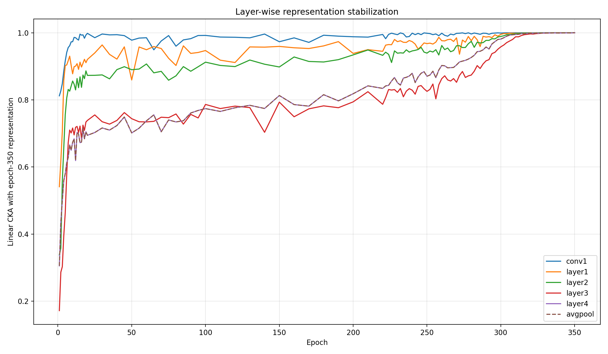
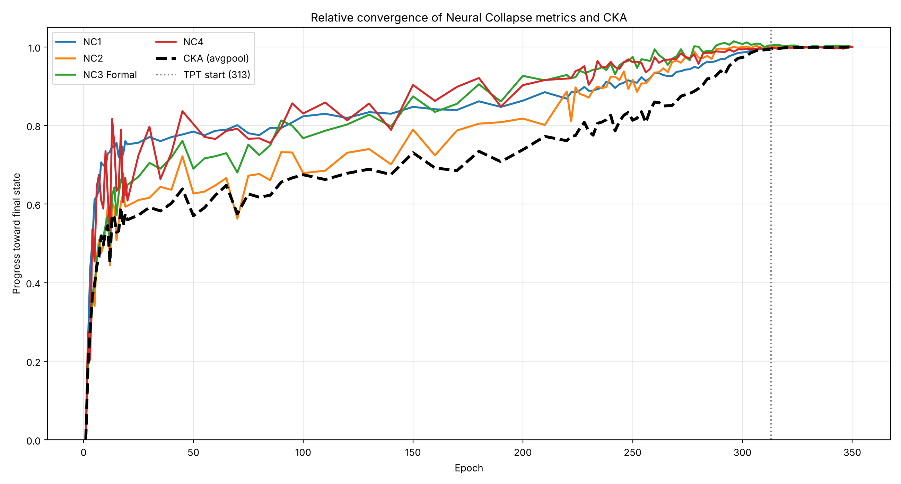
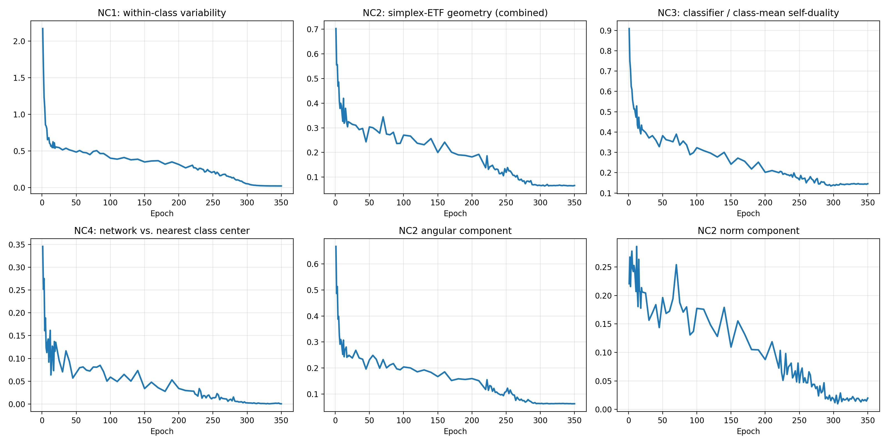
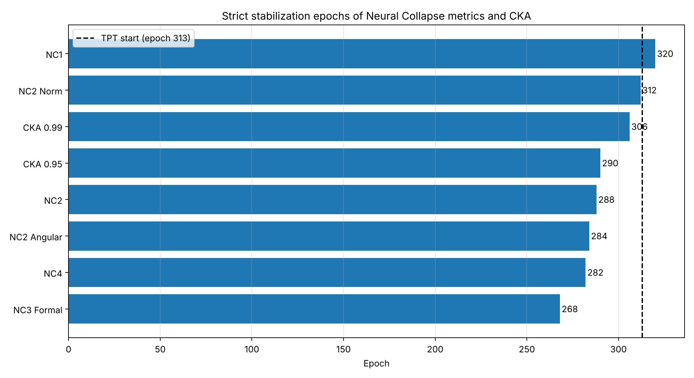
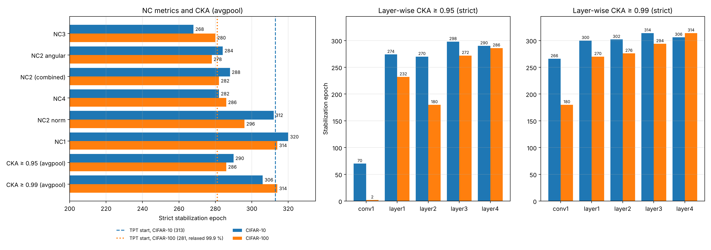

# Representation stabilization vs. Neural Collapse in ResNet-18 / CIFAR-10

Code and results for my B.Sc. thesis (University of Tehran, College of Science, supervised by Dr. Arta Jamshidi):
**"Geometrical Analysis of Deep Neural Networks"** (written in Persian; an English summary is in [`thesis/summary_en.md`](thesis/summary_en.md)).

**Question.** A network can reach 100 % training accuracy while its internal representations are still changing. When do representations actually stop changing, and how does that relate to the formation of the Neural Collapse (NC) geometry (Papyan, Han & Donoho, 2020)?

**Setup.** A CIFAR-style ResNet-18 trained from scratch on CIFAR-10 for 350 epochs (final test accuracy **95.98 %**), with 113 checkpoints saved along the way. For every checkpoint I measure
(i) how close each layer's representation is to its final one, using linear **Centered Kernel Alignment (CKA)** (Kornblith et al., 2019), and
(ii) the four **Neural Collapse** metrics NC1–NC4 on the penultimate features.

## Main findings

All "stabilization epochs" below use a *strict* rule: the first checkpoint from which the criterion holds for **every** later checkpoint.

| Quantity | Stabilization epoch | Relative to TPT (epoch 313) |
|---|---|---|
| NC3 (classifier ↔ class means) | 268 | before |
| NC4 (classifier ≡ nearest class center) | 282 | before |
| NC2 angular (simplex-ETF angles) | 284 | before |
| NC2 combined | 288 | before |
| CKA (avgpool features) ≥ 0.95 | 290 | before |
| CKA (avgpool features) ≥ 0.99 | 306 | before |
| NC2 norm (equal class-mean norms) | 312 | before |
| NC1 (within-class variability) | 320 | **after** |

TPT = Terminal Phase of Training, here the first epoch with 100 % training accuracy (epoch 313).

1. **Zero training error is not the end of learning.** NC1 only stabilizes 7 epochs *after* the terminal phase starts, and the training loss keeps moving (≈ 0.0016–0.0021 over epochs 309–350) while accuracy is saturated.
2. **Representation stability and NC geometry are related but not the same event.** NC3, NC4 and NC2 stabilize first, then the representation (CKA) approaches its final state, and NC1 settles last. The gap between the CKA 0.95 and 0.99 thresholds (290 → 306) shows that "stable" depends on how strictly it is defined.
3. **Layers do not stabilize at the same time.** With strict stabilization, conv1 reaches CKA ≥ 0.95 at epoch 70, whereas layer1–layer4 do so between epochs 270 and 298. At CKA ≥ 0.99 every layer stabilizes between epochs 266 and 314, i.e. in the last quarter of training.

| Layer | CKA ≥ 0.95 | CKA ≥ 0.99 |
|---|---|---|
| conv1 | 70 | 266 |
| layer1 | 274 | 300 |
| layer2 | 270 | 302 |
| layer3 | 298 | 314 |
| layer4 | 290 | 306 |

Full table including the (non-strict) first-crossing epochs: [`results/metrics/cka_stabilization_summary.csv`](results/metrics/cka_stabilization_summary.csv).

<p align="center"> </p>
<p align="center"> </p>

## Repository structure

```
notebooks/
  01_train_resnet18_cifar10.ipynb         train 350 epochs, save 113 checkpoints
  02_compute_cka.ipynb                    layer-wise linear CKA vs. the final model
  03_compute_neural_collapse.ipynb        NC1-NC4 for every checkpoint
  04_compare_cka_and_neural_collapse.ipynb  stabilization comparison, TPT, figures
  cifar100/                               the same four notebooks for CIFAR-100
results/
  metrics/  figures/                      CIFAR-10 results (the thesis)
  cifar100/metrics/  cifar100/figures/    CIFAR-100 results
  comparison_cifar10_vs_cifar100.csv      stabilization epochs of both datasets side by side
thesis/
  thesis.pdf                              full thesis (Persian)
  summary_en.md                           English summary
```

## Reproducing the results

**Quick look, no GPU needed.** Notebook 04 only needs the CSVs in `results/metrics/`. Run it from the repository root or from `notebooks/` and it regenerates the stabilization table and comparison figures.

**Full pipeline** (developed and run on Kaggle with a GPU):

1. Run `01_train_resnet18_cifar10.ipynb`. It writes `checkpoints/epoch_{N}.pth` (113 files, ≈ 45 MB each), `training_history.csv` and `final_model.pth`.
   Pre-trained checkpoints: **[LINK TO KAGGLE DATASET / HUGGING FACE]**.
2. Run `02_compute_cka.ipynb` and `03_compute_neural_collapse.ipynb`. Set `CHECKPOINT_DIR` in the configuration cell to the folder with the checkpoints.
3. Run `04_compare_cka_and_neural_collapse.ipynb`. Put `CKA_results.csv`, `NC_results.csv` and `training_history.csv` in the working directory (or leave them in `results/metrics/`).

Install dependencies with `pip install -r requirements.txt`. On Kaggle, the preinstalled environment is sufficient.

**Reproducibility.** Training uses seed 42 but not deterministic cuDNN, so a retrained model will be close to, but not identical with, mine. Notebooks 02–04 were run twice on the same checkpoints; the second run reproduced every stabilization epoch in the table above (CKA values agree to ~1e-7; NC values differ by at most ~0.01, mostly in the earliest epochs, because of augmentation noise, see below).

## CIFAR-100 replication

To test whether the timing pattern depends on the dataset, the full pipeline was repeated on CIFAR-100 (100 classes, 500 training images per class) with an identical architecture, optimizer, schedule, seed and checkpoint epochs. The notebooks are in [`notebooks/cifar100/`](notebooks/cifar100) and are run in the same order (01 → 02 → 03 → 04); results go to `results/cifar100/`.
Pre-trained CIFAR-100 checkpoints: [LINK TO KAGGLE DATASET](https://www.kaggle.com/datasets/parinazghasemi/resnet18-cifar100-checkpoints).

Differences from the CIFAR-10 setup:

- 100 output classes, CIFAR-100 normalization statistics; NC metrics use `C = 100` classes (the 512-d feature space is large enough for a 100-class simplex ETF).
- **Terminal phase of training.** With augmentation, the running training accuracy on CIFAR-100 peaks at 99.99 % and never reaches 100 %, so the "first epoch with 100 % training accuracy" definition used for CIFAR-10 cannot be applied. Notebook 04 therefore uses a relaxed, configurable threshold (`TPT_ACC_THRESHOLD = 99.9`, i.e. ≤ 0.1 % running training error; first reached at epoch 281). Conclusions that depend on "before/after TPT" are sensitive to this choice and should be read accordingly.
- **NC4 stabilization rule.** The CIFAR-100 analysis (and the comparison below) uses `final value + 0.01`, i.e. one percentage point of test-set disagreement above the final value: a multiplicative rule such as 1.2 × final is unusable for NC4 because the final value is close to zero, and the fixed 0.01 used for CIFAR-10 is below the CIFAR-100 final value (0.031). On CIFAR-10 the two rules give the same epoch (282), so the CIFAR-10 notebooks and results are unchanged. Notebook 04 prints the sensitivity to the tolerance (0.005 / 0.01 / 0.02).
- Final test accuracy of the CIFAR-100 model: **78.74 %** (best 79.00 % at epoch 335).

## CIFAR-10 vs CIFAR-100

Strict stabilization epochs (same rules for both datasets, notebooks in `notebooks/` and `notebooks/cifar100/`):

| Quantity | CIFAR-10 | CIFAR-100 |
|---|---|---|
| NC3 | 268 | 280 |
| NC2 angular | 284 | 278 |
| NC2 combined | 288 | 282 |
| NC4 | 282 | 286 |
| NC2 norm | 312 | 296 |
| NC1 | 320 | 314 |
| CKA (avgpool) ≥ 0.95 | 290 | 286 |
| CKA (avgpool) ≥ 0.99 | 306 | 314 |
| TPT start | 313 (100 % training accuracy) | 281 (relaxed: ≥ 99.9 %) |

| Final state (epoch 350) | CIFAR-10 | CIFAR-100 |
|---|---|---|
| Test accuracy | 95.98 % | 78.74 % |
| Max. running training accuracy | 100 % | 99.99 % |
| NC1 / NC2 / NC3 | 0.021 / 0.066 / 0.146 | 0.113 / 0.083 / 0.187 |
| NC4 (test disagreement) | 0.0004 | 0.031 |

<p align="center"></p>

**What is the same on both datasets**

- Everything stabilizes late: all NC metrics and the avgpool CKA ≥ 0.95 settle only in the last ~70–80 epochs (from epoch 268 on CIFAR-10, 278 on CIFAR-100), during the tail of the cosine learning-rate schedule.
- The geometry of the class means and the classifier (NC3, NC2 angular) stabilizes first, and within-class collapse (NC1) is the last NC component.
- The representation reaches CKA ≥ 0.95 within 8 epochs of NC2 and NC4 on both datasets, while the stricter CKA ≥ 0.99 trails the geometry (306 / 314).
- The stabilization definition matters equally: the first time conv1 reaches CKA 0.99 is epoch 15 (CIFAR-10) and 6 (CIFAR-100), but it only stays there from epoch 266 and 180; for layer1 at 0.95 the corresponding numbers are 30 → 274 and 18 → 232.
- layer3 and layer4 are the last two layers to stabilize at both thresholds.

**What differs**

- **Collapse is much weaker on CIFAR-100** (NC1 is 5× higher, NC4 80× higher at the end of training), consistent with the lower accuracy and the 100-class geometry.
- **Layer-wise ordering is cleaner on CIFAR-100.** At CKA ≥ 0.99 the stabilization epochs increase monotonically with depth (180, 270, 276, 294, 314), whereas on CIFAR-10 layer4 settles before layer3 (306 vs 314). Early layers settle earlier on CIFAR-100 (conv1 at epoch 2 vs 70 for CKA ≥ 0.95), while layer4 lags further behind (CKA 0.66 at epoch 200, vs 0.82 on CIFAR-10).
- **The relation to TPT does not transfer.** On CIFAR-10 all NC components except NC1, and the CKA, stabilize before TPT. On CIFAR-100 the training accuracy never reaches 100 %, and the TPT epoch depends strongly on the threshold used: 272, 278, 281, 284 and 290 for ≥ 99.5, 99.8, 99.9, 99.95 and 99.97 %. With the 99.9 % threshold two events (NC2 angular, NC3) precede it; with 99.5 % none does. Hence, on CIFAR-100, the NC components stabilize at about the time the training accuracy saturates, not clearly before it.

**Caveats.** One training run per dataset. NC4's stabilization epoch is sensitive to the tolerance (0.005 / 0.01 / 0.02 gives 288 / 282 / 258 on CIFAR-10 and 304 / 286 / 278 on CIFAR-100). The CIFAR-100 TPT is a relaxed definition and should not be compared directly with CIFAR-10's.

## Method in brief

- **Model:** torchvision ResNet-18 with a 3×3 stride-1 `conv1` and no max-pool (CIFAR variant), 10 outputs.
- **Training:** SGD (lr 0.1, momentum 0.9, weight decay 5e-4, batch 128), cosine annealing to 1e-5 over 350 epochs, random crop (padding 4) + horizontal flip.
- **Checkpoints:** epochs 1–20, 25–100 (step 5), 110–210 (step 10) and 220–350 (step 2): 113 in total.
- **CKA:** linear CKA between each checkpoint's features and the epoch-350 features of the same layer, on a fixed random subset of 1,000 CIFAR-10 test images. Layers: `conv1`, `layer1`–`layer4`, `avgpool`.
- **Neural Collapse:** NC1 = σ²_W / σ²_B; NC2 = combined angular error to a simplex ETF and class-mean-norm variation; NC3 = Frobenius distance between normalized classifier weights and normalized centered class means; NC4 = disagreement between the network and the nearest-class-center classifier. Details are in notebook 03.
- **Stabilization:** NC1, NC2, NC3 (and the NC2 parts) stabilize when the metric stays ≤ 1.2 × its final value; NC4 when it stays ≤ 0.01 (in the CIFAR-100 follow-up: ≤ its final value + 0.01, which gives the same CIFAR-10 epoch); CKA when it stays ≥ 0.95 or ≥ 0.99.

## Notes and limitations

Please read these before comparing the code with the thesis text.

- **One run, one setting.** A single training run (seed 42) of one architecture on one dataset. Whether the timing pattern holds for other architectures, datasets or schedules is open. All layers stabilize late in training, which coincides with the tail of the cosine learning-rate schedule, so part of the effect may be schedule-driven; I have not tested this.
- **Layer-wise CKA uses spatially pooled features.** Feature maps `(N, C, H, W)` are averaged over `H, W` before CKA. Consequently `layer4` and `avgpool` are identical representations, and early layers may look more stable than they would on full feature maps. Notebook 02 has a flag (`POOL_SPATIAL = False`) for the unpooled variant; I have not run it.
- **CKA subset.** CKA uses 1,000 fixed test images and `conv1` is taken before BatchNorm/ReLU.
- **NC features use augmented training images.** NC1–NC3 are computed on the 50,000 training images with the training augmentation (random crop + flip) applied, model in `eval()` mode, so the values carry a small amount of noise (≈ 0.5 % between repeated passes). Notebook 03 has `AUGMENT_TRAIN_FEATURES = False` for a clean, deterministic variant.
- **NC4 uses the test set.** Disagreement is measured on the 10,000 test images, with class means computed from the training features. For CIFAR-10 its stabilization threshold is an absolute 0.01, because the final value (4 / 10,000) makes a "1.2 × final" threshold meaningless; the CIFAR-100 follow-up uses `final + 0.01` (a fixed 0.01 is below the CIFAR-100 final value of 0.031), which gives the same CIFAR-10 epoch (282).
- **NC2 angular error** is the root-mean-square of the entries of `G − G_ETF` (equal to the Frobenius norm divided by the number of classes).
- **TPT definition.** The training accuracy used to locate TPT is the running accuracy over the augmented batches of each epoch, not a separate clean pass. Even after epoch 313 it fluctuates between 99.988 % and 100 %.

## Relation to the thesis

The thesis text, tables and figures correspond to the CIFAR-10 results in this repository. The only analysis difference introduced afterwards is the NC4 stabilization threshold of the CIFAR-100 follow-up (`final + 0.01` instead of a fixed 0.01), needed because the CIFAR-100 final NC4 (0.031) is above 0.01; on CIFAR-10 both rules give epoch 282.

## References

- S. Kornblith, M. Norouzi, H. Lee, G. Hinton. *Similarity of Neural Network Representations Revisited.* ICML 2019.
- V. Papyan, X. Y. Han, D. L. Donoho. *Prevalence of neural collapse during the terminal phase of deep learning training.* PNAS 117(40), 2020.
- K. He, X. Zhang, S. Ren, J. Sun. *Deep Residual Learning for Image Recognition.* CVPR 2016.

## Author

Parinaz Ghasemi: [Email](mailto:parinazghasemii.83@gmail.com) · [LinkedIn](www.linkedin.com/in/parinaz-ghasemi-908a27449). Released under the MIT License (see `LICENSE`).
