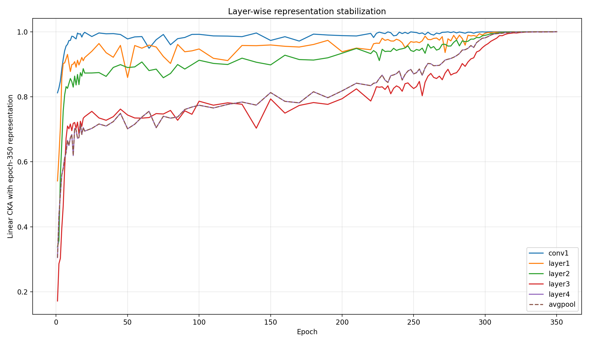
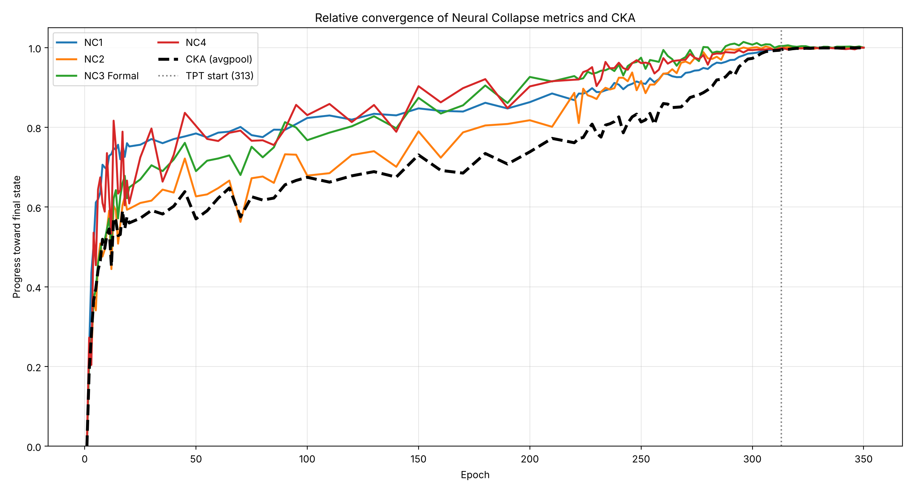
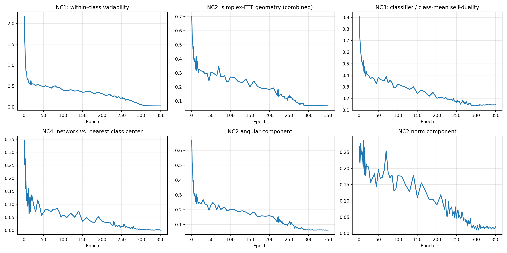
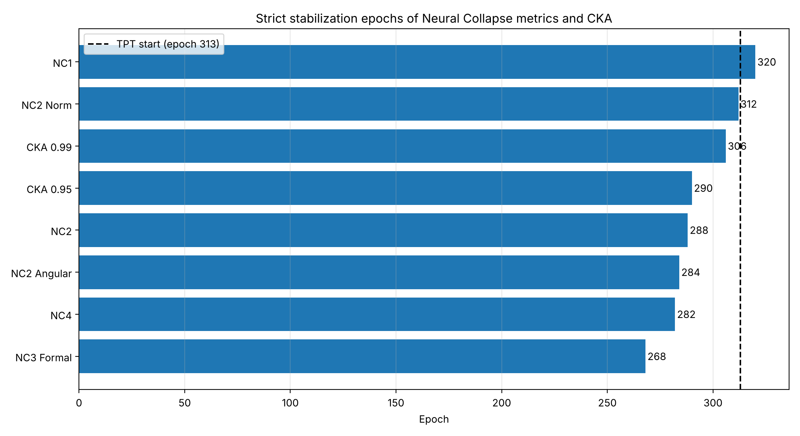

# Representation stabilization vs. Neural Collapse in ResNet-18 / CIFAR-10

Code and results for my B.Sc. thesis (University of Tehran, College of Science, supervised by Dr. Arta Jamshidi):
**"Geometrical Analysis of Deep Neural Networks"** (written in Persian; an English summary is in [`thesis/summary_en.md`](thesis/summary_en.md)).

**Question.** A network can reach 100 % training accuracy while its internal representations are still changing. When do representations actually stop changing, and how does that relate to the formation of the Neural Collapse (NC) geometry (Papyan, Han & Donoho, 2020)?

**Setup.** A CIFAR-style ResNet-18 trained from scratch on CIFAR-10 for 350 epochs (final test accuracy **95.98 %**), with 113 checkpoints saved along the way. For every checkpoint I measure
(i) how close each layer's representation is to its final one, using linear **Centered Kernel Alignment (CKA)** (Kornblith et al., 2019), and
(ii) the four **Neural Collapse** metrics NC1–NC4 on the penultimate features.

## Main findings

All "stabilization epochs" below use a *strict* rule: the first checkpoint from which the criterion holds for **every** later checkpoint.

| Quantity | Stabilization epoch | Relative to TPT (epoch 313) |
|---|---|---|
| NC3 (classifier ↔ class means) | 268 | before |
| NC4 (classifier ≡ nearest class center) | 282 | before |
| NC2 angular (simplex-ETF angles) | 284 | before |
| NC2 combined | 288 | before |
| CKA (avgpool features) ≥ 0.95 | 290 | before |
| CKA (avgpool features) ≥ 0.99 | 306 | before |
| NC2 norm (equal class-mean norms) | 312 | before |
| NC1 (within-class variability) | 320 | **after** |

TPT = Terminal Phase of Training, here the first epoch with 100 % training accuracy (epoch 313).

1. **Zero training error is not the end of learning.** NC1 only stabilizes 7 epochs *after* the terminal phase starts, and the training loss keeps moving (≈ 0.0016–0.0021 over epochs 309–350) while accuracy is saturated.
2. **Representation stability and NC geometry are related but not the same event.** NC3, NC4 and NC2 stabilize first, then the representation (CKA) approaches its final state, and NC1 settles last. The gap between the CKA 0.95 and 0.99 thresholds (290 → 306) shows that "stable" depends on how strictly it is defined.
3. **Layers do not stabilize at the same time.** With strict stabilization, conv1 reaches CKA ≥ 0.95 at epoch 70, whereas layer1–layer4 do so between epochs 270 and 298. At CKA ≥ 0.99 every layer stabilizes between epochs 266 and 314, i.e. in the last quarter of training.

| Layer | CKA ≥ 0.95 | CKA ≥ 0.99 |
|---|---|---|
| conv1 | 70 | 266 |
| layer1 | 274 | 300 |
| layer2 | 270 | 302 |
| layer3 | 298 | 314 |
| layer4 | 290 | 306 |

Full table including the (non-strict) first-crossing epochs: [`results/metrics/cka_stabilization_summary.csv`](results/metrics/cka_stabilization_summary.csv).

<p align="center"> </p>
<p align="center"> </p>

## Repository structure

```
notebooks/
  01_train_resnet18_cifar10.ipynb         train 350 epochs, save 113 checkpoints
  02_compute_cka.ipynb                    layer-wise linear CKA vs. the final model
  03_compute_neural_collapse.ipynb        NC1-NC4 for every checkpoint
  04_compare_cka_and_neural_collapse.ipynb  stabilization comparison, TPT, figures
results/
  metrics/                                per-epoch CSVs and stabilization tables
  figures/                                all figures
thesis/
  thesis.pdf                              full thesis (Persian)
  summary_en.md                           English summary
```

## Reproducing the results

**Quick look, no GPU needed.** Notebook 04 only needs the CSVs in `results/metrics/`. Run it from the repository root or from `notebooks/` and it regenerates the stabilization table and comparison figures.

**Full pipeline** (developed and run on Kaggle with a GPU):

1. Run `01_train_resnet18_cifar10.ipynb`. It writes `checkpoints/epoch_{N}.pth` (113 files, ≈ 45 MB each), `training_history.csv` and `final_model.pth`.
   Pre-trained checkpoints: **[https://www.kaggle.com/datasets/parinazghasemi/resnet18-cifar10-checkpoints]**.
2. Run `02_compute_cka.ipynb` and `03_compute_neural_collapse.ipynb`. Set `CHECKPOINT_DIR` in the configuration cell to the folder with the checkpoints.
3. Run `04_compare_cka_and_neural_collapse.ipynb`. Put `CKA_results.csv`, `NC_results.csv` and `training_history.csv` in the working directory (or leave them in `results/metrics/`).

Install dependencies with `pip install -r requirements.txt`. On Kaggle, the preinstalled environment is sufficient.

**Reproducibility.** Training uses seed 42 but not deterministic cuDNN, so a retrained model will be close to, but not identical with, mine. Notebooks 02–04 were run twice on the same checkpoints; the second run reproduced every stabilization epoch in the table above (CKA values agree to ~1e-7; NC values differ by at most ~0.01, mostly in the earliest epochs, because of augmentation noise, see below).

## Method in brief

- **Model:** torchvision ResNet-18 with a 3×3 stride-1 `conv1` and no max-pool (CIFAR variant), 10 outputs.
- **Training:** SGD (lr 0.1, momentum 0.9, weight decay 5e-4, batch 128), cosine annealing to 1e-5 over 350 epochs, random crop (padding 4) + horizontal flip.
- **Checkpoints:** epochs 1–20, 25–100 (step 5), 110–210 (step 10) and 220–350 (step 2): 113 in total.
- **CKA:** linear CKA between each checkpoint's features and the epoch-350 features of the same layer, on a fixed random subset of 1,000 CIFAR-10 test images. Layers: `conv1`, `layer1`–`layer4`, `avgpool`.
- **Neural Collapse:** NC1 = σ²_W / σ²_B; NC2 = combined angular error to a simplex ETF and class-mean-norm variation; NC3 = Frobenius distance between normalized classifier weights and normalized centered class means; NC4 = disagreement between the network and the nearest-class-center classifier. Details are in notebook 03.
- **Stabilization:** NC1, NC2, NC3 (and the NC2 parts) stabilize when the metric stays ≤ 1.2 × its final value; NC4 when it stays ≤ 0.01; CKA when it stays ≥ 0.95 or ≥ 0.99.

## Notes and limitations

Please read these before comparing the code with the thesis text.

- **One run, one setting.** A single training run (seed 42) of one architecture on one dataset. Whether the timing pattern holds for other architectures, datasets or schedules is open. All layers stabilize late in training, which coincides with the tail of the cosine learning-rate schedule, so part of the effect may be schedule-driven; I have not tested this.
- **Layer-wise CKA uses spatially pooled features.** Feature maps `(N, C, H, W)` are averaged over `H, W` before CKA. Consequently `layer4` and `avgpool` are identical representations, and early layers may look more stable than they would on full feature maps. Notebook 02 has a flag (`POOL_SPATIAL = False`) for the unpooled variant; I have not run it.
- **CKA subset.** CKA uses 1,000 fixed test images and `conv1` is taken before BatchNorm/ReLU.
- **NC features use augmented training images.** NC1–NC3 are computed on the 50,000 training images with the training augmentation (random crop + flip) applied, model in `eval()` mode, so the values carry a small amount of noise (≈ 0.5 % between repeated passes). Notebook 03 has `AUGMENT_TRAIN_FEATURES = False` for a clean, deterministic variant.
- **NC4 uses the test set.** Disagreement is measured on the 10,000 test images, with class means computed from the training features. Its stabilization threshold is absolute (0.01), because the final value (4 / 10,000) makes a "1.2 × final" threshold meaningless.
- **NC2 angular error** is the root-mean-square of the entries of `G − G_ETF` (equal to the Frobenius norm divided by the number of classes).
- **TPT definition.** The training accuracy used to locate TPT is the running accuracy over the augmented batches of each epoch, not a separate clean pass. Even after epoch 313 it fluctuates between 99.988 % and 100 %.


## References

- S. Kornblith, M. Norouzi, H. Lee, G. Hinton. *Similarity of Neural Network Representations Revisited.* ICML 2019.
- V. Papyan, X. Y. Han, D. L. Donoho. *Prevalence of neural collapse during the terminal phase of deep learning training.* PNAS 117(40), 2020.
- K. He, X. Zhang, S. Ren, J. Sun. *Deep Residual Learning for Image Recognition.* CVPR 2016.

## Author

Parinaz Ghasemi: [parinazghasemii.83@gmail.com / www.linkedin.com/in/parinaz-ghasemi-908a27449]. Released under the MIT License (see `LICENSE`).
